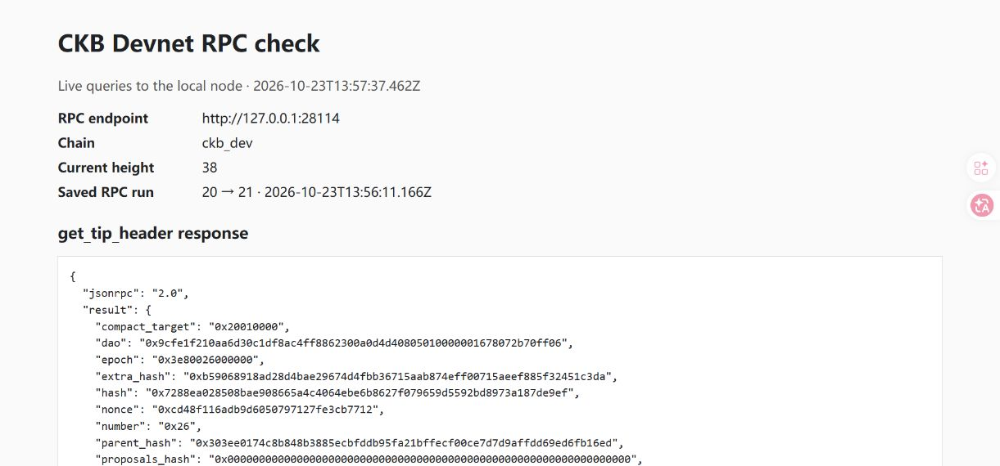

# 第1周：先理清 Cell 和交易

2026-10-23

今天先看了 CKB 的基础介绍和快速入门，也浏览了 CCC 的介绍。重点放在 Cell、交易的输入输出，以及 Lock Script 和 Type Script 的区别。

Cell 的更新方式是这次学习的重点：数据不是直接在原来的 Cell 上修改，而是消耗旧 Cell，再创建新 Cell。Lock Script 管谁能花费，Type Script 则约束数据或资产的变化规则。后面做数据存储练习时，还要把这套过程实际跑一遍。

## 容量计算练习

练习从转账的容量计算开始。200 CKB 的输入，给收款方 100 CKB，找零 99.999 CKB，剩下 0.001 CKB 作为手续费。代码用 BigInt 计算，避免小数精度问题。另外检查了输出超过输入、负数输入和多个输入求和，4项检查都通过了。

- [练习代码](../exercises/week-01/capacity.mjs)
- [运行记录](../evidence/week-01/run.json)
- 环境：Node.js v24.19.0

在仓库根目录运行：

```sh
node exercises/week-01/capacity.mjs
```

## 开发链和 RPC

继续把本地环境补上了，用的是 OffCKB 0.4.13 和 CKB 0.210.0。配置和链数据放在仓库的 `.local` 目录，启动时指定本地 `ckb.exe`。启动后节点在 8114 端口提供 RPC，OffCKB 的代理在 28114。

写了一个查询脚本，先查看链名称，再读取区块头、按哈希查回区块头，最后查询创世块哈希。返回的链名称是 `ckb_dev`，检查期间区块高度从20变成了21。

第一次检查没通过：两次查询只间隔3.5秒，高度没变化。翻了生成的矿工配置，出块间隔是5秒。把检查改成每秒查询、最多等待15秒后就通过了。

- [安装和启动方法](../exercises/week-01/README.md)
- [RPC 查询脚本](../exercises/week-01/rpc-check.mjs)
- [原始请求与响应](../evidence/week-01/devnet-rpc.json)
- [环境版本](../evidence/week-01/devnet-environment.json)
- [启动日志](../evidence/week-01/devnet-startup.log)
- [第一次检查的记录](../evidence/week-01/rpc-first-attempt.txt)

为了查看结果，做了一个本地查看页面。打开页面会重新查询节点并运行容量练习，截图时区块高度已经到了38。

也试了直接查询节点的8114端口，高度从82增长到了83，与代理返回的创世块哈希一致。



收尾时还碰到一个 Windows 兼容问题：`offckb node stop` 要用 WMIC 识别进程，这台电脑没有这个命令。补了一个用 `Get-CimInstance` 核对进程后再停止的脚本，放在练习目录里。

又试了一次停止后重启，区块高度继续从106增长到107，链数据保留了下来。[重启后的查询结果](../evidence/week-01/resume-rpc.json)和[启动停止记录](../evidence/week-01/restart-check.json)也一起保存了。验证结束后，开发链和本地查看服务都已停止。

## 接下来

基础环境和查询已经跑通，还没有发送交易。下一次做一次带找零的转账，看看输入 Cell 如何被消耗，以及收款和找零 Cell 怎样生成。

项目方向先记下一个想法：把文件摘要存进 Cell，之后读取出来核对文件有没有变化。先完成基础练习，再决定具体怎么做。

## 参考资料

- [CKB 基础](https://docs.nervos.org/docs/getting-started/how-ckb-works)
- [快速入门](https://docs.nervos.org/docs/getting-started/quick-start)
- [CCC 介绍](https://docs.ckbccc.com/en/docs/getting-started/introduction)
- [OffCKB 使用方法](https://docs.nervos.org/docs/sdk-and-devtool/offckb)
