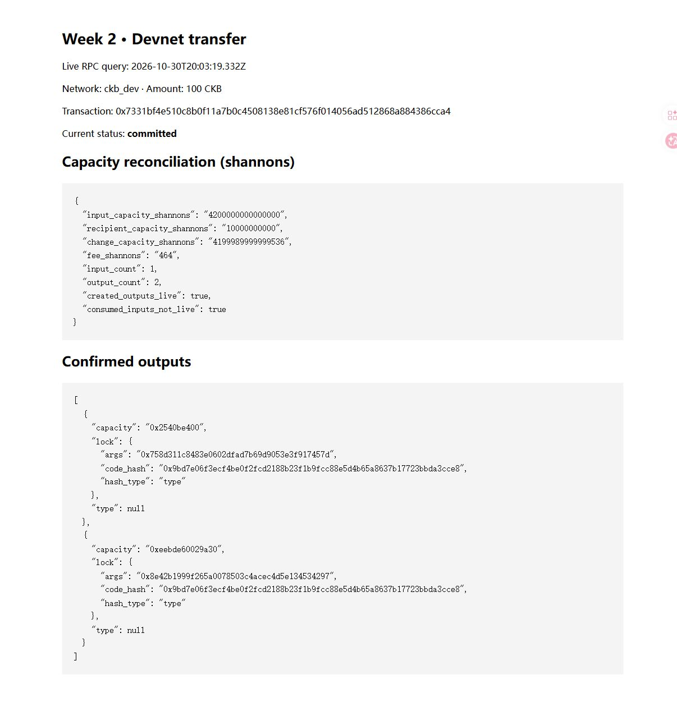

# Week 2: Sending CKB and following the change

October 31, 2026 (Asia/Shanghai)

This session was scheduled for October 30 at 20:00 and ran overnight on October 31.

Last week's capacity exercise had the right basic shape: spend an input, create a recipient output, return the change, and leave the difference as the fee. This week I followed that through on the local Devnet rather than stopping at the arithmetic.

## The transfer

I used the first two bundled OffCKB accounts and sent 100 CKB from account 0 to account 1. OffCKB handled transaction construction and signing; the exercise script then fetched the confirmed transaction and checked its inputs and outputs through RPC.

Transaction: `0x7331bf4e510c8b0f11a7b0c4508138e81cf576f014056ad512868a884386cca4`

The transaction reached `committed`. It spent one input and created two outputs:

| Item | Capacity in shannons |
| --- | ---: |
| Input | 4,200,000,000,000,000 |
| Recipient (100 CKB) | 10,000,000,000 |
| Change | 4,199,989,999,999,536 |
| Fee | 464 |

The recipient output has account 1's lock, and the change output has account 0's lock. Both new outputs were live when queried. The input no longer appeared in the live Cell set.

## Things I had to fix

The transfer command required a signing key; it didn't automatically choose the first account. I loaded the bundled Devnet key into memory and passed it through the child process environment, keeping it out of the command line and saved output.

Next, OffCKB couldn't run `list-hashes`. Starting the node with a custom binary path hadn't registered that binary for the transfer command's lookup. I added a small setup script to copy the verified CKB binary into this project's local OffCKB binary directory and set its version there.

One check also expected a spent input to return `dead`, but this node returned `unknown`. The RPC reference says the distinction is deprecated. I changed the check to combine the committed transaction's input reference with the fact that the old Cell is no longer live. The transaction was already committed at that point, so I resumed verification using its saved hash instead of sending another transfer.

## Files and next steps

- [Exercise and reproduction steps](../exercises/week-02/README.md)
- [Transaction, resolved inputs, and RPC trace](../evidence/week-02/transfer.json)
- [Transfer command output](../evidence/week-02/transfer-command.json)
- [First attempt](../evidence/week-02/first-attempt.json)

Next week I'll store data in a Cell and read it back. The input/output model is clearer now that I've followed an actual transfer and its change output.

References: [Transfer CKB](https://docs.nervos.org/docs/dapp/transfer-ckb), [OffCKB](https://docs.nervos.org/docs/sdk-and-devtool/offckb), and the [CellWithStatus RPC reference](https://docs.rs/crate/ckb-rpc/1.2.1/source/README.md).
