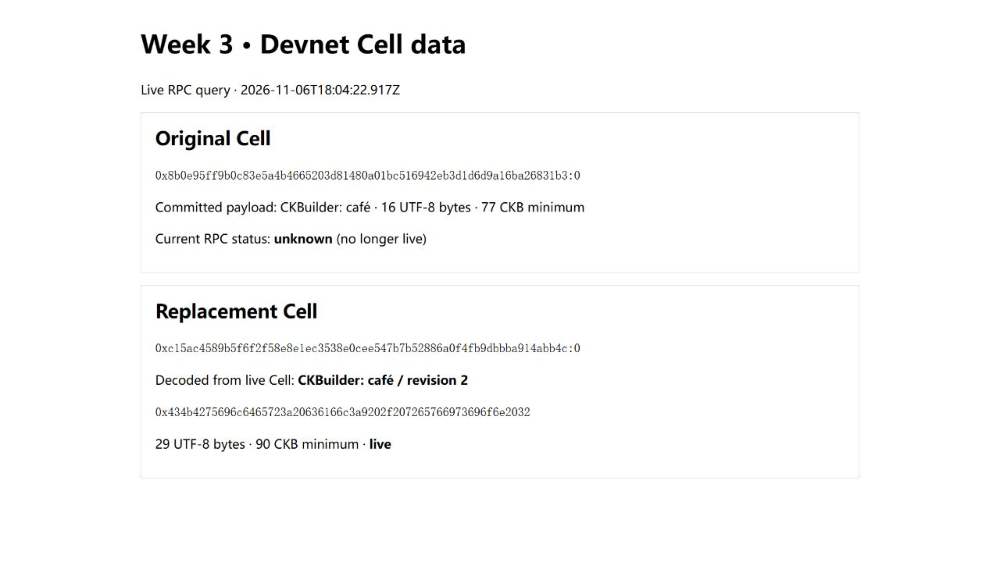

# Week 3: Storing and replacing Cell data

November 7, 2026 (Asia/Shanghai). Scheduled for November 6; run manually after the planned start was missed.

Last week's transfer left one input spent and two new outputs live. I used the same idea to update a message: the second transaction spends the first message Cell and creates a new one with different data.

I started with `CKBuilder: café` so the byte count wouldn't be the same as the character count. The `é` takes two UTF-8 bytes. I stored the hex in `outputs_data`, waited for the transaction to be committed, then read output 0 with `get_live_cell` and decoded the bytes back to the original string.

| Version | UTF-8 payload | Payload bytes | Minimum capacity |
| --- | --- | ---: | ---: |
| 1 | `CKBuilder: café` | 16 | 77 CKB |
| 2 | `CKBuilder: café / revision 2` | 29 | 90 CKB |

For these Cells, the capacity field takes 8 bytes, the lock takes 53 bytes, and there is no type script. That gives 61 bytes before the payload. The extra 13 bytes in version 2 raised the minimum by 13 CKB.

The second transaction explicitly referenced the first Cell as an input. After it was committed, the old outpoint returned `unknown` from `get_live_cell`, and the replacement returned `live` with the revised text. I could still read the original bytes from the first committed transaction.

- [Run the exercise](../exercises/week-03/README.md)
- [Transaction hashes, payload bytes, and RPC responses](../evidence/week-03/cell-data.json)

Next up: token Cells and checking that the quantities add up before and after a transfer.

Reference: [Store Data on Cell](https://docs.nervos.org/docs/dapp/store-data-on-cell).
